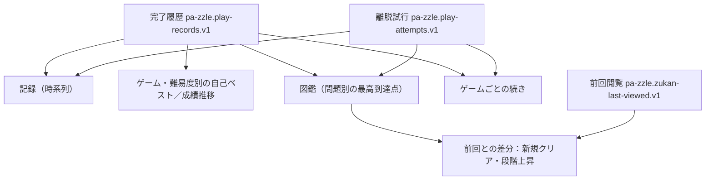

# 成績・図鑑・履歴を「また遊びたくなる成果」にするための調査（#662）

調査基準: 2026-11-07〜08、先行調査は`main` `add7b90d4d6889973f92ca8af84d2251c3366a17`、最終追加検証は`main` `519f1fdecf90beb24e6b3516a1fafbfdaa7e0969`。親Issue: #676。対象: RQ-004/005/006/009/010、FR-006〜011/018〜026、NFR-010/011。この文書は**調査と採用判断の材料**であり、要件・仕様を変更する正本ではない。実行した検査、コードからの判断、未検証の体験仮説を区別する。

## 結論：記録を残せるだけでなく、成果を理解して次に進めるか

1プレイの達成、問題1問の収集、同ゲーム×難易度の自己ベスト、全ゲームの時系列履歴は**別々の成果**である。#662の目的は保存件数やテスト件数の証明ではなく、これらが「解く→結果→見返す→次の一問を選ぶ」体験でつながるか、改善の採用判断まで確定すること。

- **結果の伝え方:** 先行調査ではmainとPR #640のウォーターソート5場面を390pxの実DOMで比較。#640は43点でも「クリア」を主役にして数字偏重を改善するが、3指標更新時に内訳を開くと主ボタン「次の問題」の下端が758→1,237pxへ移動（mainは716→604px）。初記録告知なし#689、非更新の比較なし#503、時間を更新したのに「0秒短縮」とする表示は#690で一体的に扱う。
- **2ゲーム横断の実画面:** 最新main `519f1fd` のSnapshotで、ウォーターソートとスライドパズルの前回図鑑閲覧状態を別々に保存→双方の完了・改善・離脱記録を投入→再入場した。ウォーターソートはクリア2/5,000、スライドパズルはクリア1/1,000＋挑戦中1を示し、ゲームの混同なし。図鑑の変化演出完了後にそれぞれの前回閲覧状態が保存され、履歴→スライドパズルの過去結果（72点）→問題選択→該当問題の詳細まで操作できた。
- **前回閲覧・比較の論理:** 一時Vitestでは初回閲覧に変化演出なし、前回からの初クリア1件と評価段階上昇1件を別判定、他ゲームの前回閲覧状態を維持。ゲーム横断で自己ベストを混同せず、同じ問題の再挑戦と別問題の収集を区別する。
- **図鑑の目的別探索:** 未挑戦・挑戦中・低評価再挑戦・特徴指定は現行各5操作でプレイ開始可能。「100点未満」はclear/good/greatの3条件が必要で7操作。**操作可能≠選びやすい**ため#666で改善案比較する。
- **長期履歴:** 600件の最古の記録は14回の追加表示・48,249pxの後に結果へ到達。最新mainの実ブラウザでは、**2ゲームの完了3,000件＋離脱1,000件、計4,000件を通常の40件ずつの追加表示で全件描画し、末尾付近の完了記録（ウォーターソート33点）から結果画面を再表示できた**。末尾の離脱記録は仕様どおりゲームホームへ移動。390×844と1280×800の両方で成功し、ページ例外・コンソールエラー・通信失敗は0件。4,000件時のDOMは92,232要素・SVG4,002個に達するため、#694では探索負担と表示済み行をすべて保持する描画方式の双方を比較する。
- **旧記録と失敗系:** 旧版の一部記録は保存された事実から現在の評価を再計算できるが、旧生成器・旧難易度の問題を今の図鑑に勝手に加えず、再プレイもできない（#506）。保存領域への書込み拒否・容量不足は保存失敗として扱う。一方、**読取り拒否だけで書込み可能な条件では、既存記録を空とみなして上書きする問題**を再現。破損読出しとともに#664/PR #685で保護する。
- **10ゲームの記録形式と要件追跡:** 最新mainで10ゲーム固有記録・図鑑・共通記録の関連32ファイル457テスト（今回の一時調査7件を含む）が成功。別のPR #691の全10ゲームLv1実盤面クリア検証も照合。FR-024〜026は既存実装とテストがあり、重複実装しない。

**採否:** 結果の称賛と比較は#690（#689/#503と整合）、図鑑の次問選択は#666、古い履歴の検索負担は#694、保存保全は#664/#684/#671、グラフは#680。結果画面に図鑑更新を重複表示したり、称号・連続日数・新採点器を追加したりしない。

**検査の境界:** ブラウザでの記録投入はメモリルーター・メモリ保存を使うため、実オリジンの`localStorage`の耐久性、再起動、実機Safari、実利用者の迷い・達成感・後日再訪までは証明しない。完了条件はこれらの未実施を明示し、実装・利用者評価を別Issueの受入条件にすることを認めている。

## 1. 何を成果と呼ぶか：四つの異なる単位

| 単位 | 遊ぶ人が知りたいこと | 根拠・出る画面 | 混同すると起きる誤解 |
| --- | --- | --- | --- |
| **プレイ1回** | 解けたか、今回どこがよかったか（低得点でも解き切った） | FR-008/018/019、SCR-004、結果 | 低い点を「達成なし」と読み違える |
| **問題1問** | この問題を初めて解いたか、以前より高い評価段階になったか、挑戦中か | RQ-010、FR-022〜025、SPEC-026、図鑑 | 同じ問題の再クリアで収集数を増やす、段階変化とスコアの微増を混同 |
| **ゲーム×難易度** | 比較可能な過去の自分より良かったか。スコアだけでなく時間・手数・ミスなど各指標 | FR-010/021、SPEC-002、結果の比較／ゲームのホームの成績 | 別の問題との比較であることを隠す、「100点以後は改善なし」と思わせる |
| **ゲーム横断の時間** | いつ、どのゲームを、どれだけ遊んだか | RQ-005、SPEC-001、SCR-005、記録 | 記録画面をランキング・図鑑・ベストの重複画面にする |

**初クリア、評価上昇、初記録、自己ベスト更新、更新なしの5場面は相互排他的ではない。** 例: 同難易度の別問題の初クリアと「自己ベスト更新なし」は同時に成立する。従って5つの排他的な報酬を設計するのではなく、問題ごとの収集状態（新規／段階上昇／変化なし）とゲーム×難易度の比較状態（初記録／ベスト更新／更新なし）を別軸で検査する。

## 2. 5場面の実形式データによる比較

ウォーターソートの問題集に実在する2問題のidentityと採点定義を使い、順に完了記録を追加して `getPlayRecordSaveOutcome`、`deriveGameZukan`、`findZukanChanges` を一時Vitestで確認（1件成功）。数値は**テスト用の人工プレイ**で、実ユーザーの得点分布ではない。

| 場面 | 得点 | 同難易度の比較 | 問題ごとの図鑑の変化 | 利用者に届く意味・評価 |
| --- | ---: | --- | --- | --- |
| A 最初の問題の初クリア | **43** | `first-record` | クリア数0→1、新規1マス | 低得点でも「解き切った」「初めて記録を残した」「集めた」の3つ。結果の初記録告知は**欠落** #689 |
| B 同じ問題の改善 | **100** | `updated`、スコア・時間差・手数差の**3指標** | クリア数1のまま、段階上昇1マス | 結果で自己ベスト更新、図鑑で塗り替え。別の画面で別の価値を返すのは正常 |
| C 100点のまま時間短縮 | **100** | `updated`、**時間差だけ** | 段階変化なし | 点数が上限でも伸びしろがある。図鑑の色が変わらなくても矛盾ではない |
| D 別の問題を初クリア | **38** | `recorded`、ベスト更新なし | クリア数1→2、新規1マス | **今回の自己ベストは更新なしでも、遊んだ跡は増える。** 結果には過去との比較差が出ず #503。図鑑に戻れば収集を確認できる |
| E 低い成績で同じ問題を再クリア | **20** | `recorded`、ベスト更新なし | 収集・段階とも変化なし | 解けた達成は消えない。比較を示せば次の挑戦の判断材料になるが、今は欠落 #503 |

描画についても一時Reactテスト3件を実施: `first-record` は空、`updated` は「自己ベスト更新」を表示、`recorded` は空（3/3成功）。コード根拠: `frontend/src/records/save-play-record.ts`、`frontend/src/records/ui/PlayRecordOutcomeNotice.tsx`（`first-record`を`null`で返す）、`frontend/src/records/personal-best.ts`。`SPEC-002`には初記録をクリア→結果で告げる決まりがある。

**5場面の価値比較:** AとDが低得点でも収集として価値があることを評価の高低から独立させ、Cは最高スコアだけを達成とみなさない。Bの「自己ベスト」と「図鑑の色の更新」は同時に起きたが比較単位が異なる。この表は**状態が正しく計算される検証**であり、その表示を人間がどう感じるかの実証ではない。

### 実ブラウザ・同条件比較：main対PR #640（2026-11-08）

main `add7b90d` とPR #640 `98337bc` のRepository Snapshot Artifactについて各HEADとの一致を確認。ウォーターソートLv1の実在する2問題に紐づけた実形式のクリア記録を順に投入し、Chromiumの390×844で結果画面5場面を再現・操作した。**記録と結果の遷移状態を注入したテストであり、5件すべての盤面を実際に解いたテストではない。** 両版とも検証環境のみでメモリルーター・メモリ保存先を使い、実DOM・Reactの描画・クリックを確認。通常オリジンのlocalStorage保存や再起動は検証していない。5場面とも予期しない `pageerror` / `console.error` / `requestfailed` は0件。

| 場面 | mainの結果画面 | PR #640の結果画面 | 改善判断 |
| --- | --- | --- | --- |
| 43点／初クリア・初記録 | 43の数字が強い。初記録通知なし | 「クリア」の言葉を主に、43点を従にする。初記録通知なし | 通常クリアの達成語は改善仮説。初記録は双方とも仕様未達#689 |
| 100点／3指標更新 | 数値が主。更新指標は表示 | 「パーフェクト！」を主に、更新指標は維持 | 表現改善と縦の情報量を分けて判断 |
| 100点／時間だけ更新 | 得点変化なしだがPB更新 | 同様にPB更新 | 「100点以後の成長」も正しく伝える |
| 別問題38点／初クリア、PB非更新 | 比較差なし | 比較差なし | 初クリアの価値は図鑑に残る。比較情報は#503 |
| 同問題20点／PB非更新 | 比較差なし | 比較差なし | 非更新を敗北の報酬にせず、差を示す#503 |

**主操作位置の実測:** 100点で得点・時間・手数の3指標を改善した結果で、内訳を開く前後の「次の問題」ボタンの下端位置（画面上端からのY座標）をPlaywrightで測定した。

| 画面幅×高さ | main：開く前→後 | PR #640：開く前→後 | 判定 |
| --- | ---: | ---: | --- |
| 390×844 | 716→604px | **758→1,237px** | #640は内訳展開後に主操作が画面外へ出る |
| 320×568 | 716→328px | **758→915px** | #640は展開前・後とも狭い画面に主操作が収まらない |

#640は内訳を主操作の**前**に移し、mainは主操作の**後**に配置する。機能上は「次の問題」を1クリックで押せても、開いた内訳によって発見・到達できなくなるのは結果体験の退行。**評価語の視覚階層を改善する案と、主操作が押し出される並び順は分けて採否判断する。**

**独立調査との照合:** [PR #691](https://github.com/hizahizi-hizumi/pa-zzle/pull/691)はmainと#640でマインスイーパーの同じLv1問題 `frr16m084o` を実盤面操作して85→100→85点を再現。時間が1,128ms→846msへ改善したのに「0秒短縮」と表示される。改善幅は `play-record-display.ts` が秒へ切り捨て、PB判定は `personal-best.ts` がミリ秒で比較する。**「自己ベスト更新」の理由が実質0と示される矛盾**を、#690の全体設計に含める。低得点をPB更新とすること自体は、時間など指標別更新の仕様に沿うため採点バグとは断定しない。

## 3. 画面ごとに何を受け取り、次へ移るか

### 「結果」：今回の達成を受け取る

- 主役はクリアしたことと今回のスコア・主要成績。`次の問題` が主操作、`問題選択`（ゲームのホームへ移動）と `もう一度` は従操作（SCR-004、`GameResultActions.tsx`）。既存の強弱を維持する。
- `first-record` は今の実装で空表示。初記録を「そのゲーム・その難易度で最初の比較可能な記録」として静かに告げることはSPEC-002の修正であり、図鑑の新規クリア通知ではない（#689）。
- `updated` では更新した指標と前回値・今回値を表示。**得点の更新がなくても時間や手数のベストがある**。初回と別に扱う。
- `recorded` では差の表示がない。新規収集／既クリアの反復の両方が同じ表示なので、差の意味を残す修正は#503で行う。ただし低得点でも達成を弱めず、非更新を敗北の称賛なし通知にしない。
- 結果画面に「図鑑+1」「評価段階上昇」を追加しない（SCR-004、ADR-0004）。結果の演出の質は #690、採点の正しさは #279/#246/#247 と切り分ける。

### 「ゲームのホーム／図鑑」：自分の跡から自分で選ぶ

- 1問をクリアしても集計は1マスで、問題ごとに最高得点・最速・最少手数・最少ミスを別の試行から導出（SPEC-026）。数千問の台紙にクリア済み・挑戦中・未挑戦を並べ、難易度ごとに状態数を確認できる。
- 前回から新規クリア・評価段階上昇がある場合、その難易度で前回の姿から押して見せる。**各プレイ直後の結果ではなくゲームのホームでまとめて示す**のは意図された設計。前回閲覧状態がない初回は変化を演出しない（仕様どおり）。「すべての初クリアで必ず演出する」と保証してはいけない。
- マス詳細から同問題を遊べ、状態・特徴・成績による絞り込みも存在する（FR-023/025）。ただし選択肢の件数整合を確認しただけでは、**次に遊びたい1問を迷わず選べる価値**を証明しない。次の4目的の比較は #666 が責任を持つ: 未挑戦収集、未クリア攻略、得点改善、特徴で探す。
- 「問題選択」から図鑑へ到達できることはコード／画面で確認済みだが、ユーザーがその名称から収集を見る場所だと分かるかは未評価。ボタン追加・常時図鑑バッジ・自動的な図鑑への転送を先に決めない。

**4つの利用目的を使った実操作比較（Chromium 390×844）:** ウォーターソートLv1の実在問題に完了5件・離脱1件を投入し、状態数はクリア2・挑戦中1・未挑戦997。フィルタを開く→条件選択→閉じる→マス→「遊ぶ」で以下を独立に実施。画面エラー・失敗通信は0件。

| 目的 | 条件、対象・結果 | 操作数 |
| --- | --- | ---: |
| 未挑戦の収集 | 「未挑戦」997問、No.0004へ入り初期盤面 | **5** |
| 中断・未クリアの攻略 | 「挑戦中」1問、No.0003へ入り初期盤面 | **5** |
| 低評価の問題を再挑戦 | 「clear」1問、38点のNo.0002を再開始 | **5** |
| 特徴で問題を探す | 色「5種類」333問、No.0002へ入り初期盤面 | **5** |

**100点未満は同じ5操作ではない。** 別の実形式の4問に75/85/95/100点を生成して確認すると、状態はclear/good/great/perfect各1問。clear・good・greatを3回選ぶと該当3問、100点のperfectは条件外となる。次問まで**7操作**（フィルタ→3段階選択→閉じる→マス→遊ぶ）。フィルタのラベルは英語の評価段階であり、利用者の「100点未満」そのものを指定する項目は存在しない。#652のランダム出題設定とは区別して#666で検討する。いずれも条件を理解した自動操作で、認知負担は実測していない。条件外の問題は台紙から消えず後ろへ送られる。

### 「成績」：比較可能な自分の推移を理解する

- 自己ベスト・推移は選択中のゲーム・難易度だけを開いて見る（SPEC-002、ADR-0012）。これはゲーム横断の履歴と別。得点とゲーム固有の指標は意味が違い、スコア100点後の短縮も上達である。
- 図鑑の個別マスにある複数の最良値は別プレイ由来であり得る。ゲーム×難易度の自己ベストも別問題由来であり得る。**「今見ている問題のベスト」だと誤認しないか**は人間の解釈テストが必要で、現時点では表示を増やさない。
- 成績グラフは1,000件489ms、3,000件1,142ms（前段のChromium単発計測）。全点をSVGの円で描画するため長期利用に不利（#680）。ただし図鑑全体の成績表示へ統合する理由にはならない。

### 「記録」：ゲームをまたいだ時間の流れ

- 記録は全ゲームのクリア・離脱を新しい順の時系列で示し、日ごとの遊んだ量をカレンダーで見せる（SPEC-001、SCR-005）。カードを選べば結果またはゲームのホームに移動できる。成績比較はここへ戻さない（ADR-0012）。
- **古いプレイの発見を実ブラウザで確認した。** 実形式のウォーターソート完了記録600件（同一問題・異なる時刻とID・1時間間隔の約25日分）をChromium 390×844に投入。初期40件、末尾へスクロールするたびに80→120→…→600件へ追加表示し、14回の追加表示後に最古の履歴カードを選択、結果画面への移動に成功。全件描画時のページ高は**48,249px**、自動処理による追加表示は約3.5秒（利用者の探索時間ではない）。カレンダーは直近13週間の非操作表示（`role=img`）で、日付・ゲーム・問題IDによる履歴絞り込みやジャンプはない。
- **価値判断:** 最近の活動を見る時間軸は保ちつつ、古い特定プレイの発見に一覧件数に比例する負担がある。#694では日付・ゲーム・問題番号などの手掛かりを使った導線を比較し、検索欄や日付クリックを先に決め打ちしない。図鑑で問題を再挑戦することと、その問題を**過去にどう解いたか**を探すことは異なる。

## 4. 設計案の比較と採用判断

| 案 | 価値 | 懸念・費用 | 結論 |
| --- | --- | --- | --- |
| **A 既存の役割を守り、欠けた比較情報だけ補う** | 初記録・非更新も解釈でき、画面構造を保つ | #689小、#503小〜中、実画面調整必要 | **採用**。仕様・要件不一致への最小解 |
| **B 図鑑の次の挑戦への導線を比較改善** | 収集・未クリア攻略・100点未満・特徴で次問を選ぶ | 4目的の現行基線5操作、100点未満7操作。ボタン増加は複雑化の懸念 | **現行到達性は確認済み。#666で認知負担と変更前後の到達手数を比較** |
| C 結果に「図鑑+1」「色更新」「全ゲーム成績」を重ねる | 1画面ですべてを説明できる | 今回の達成がぼやけ、SCR-004・ADR-0004に反する | **不採用** |
| D 毎日の連続日数・全問進捗率・称号・報酬を足す | 継続行動の促進を狙える | RQ-010の「ノルマにしない」に反し、遊びの面白さでなく数値の達成が目的化 | **不採用** |
| E 新しい採点エンジン・ゲーム横断ランキングを追加 | 一つの数字で比べやすい | ゲーム固有の良さと比較条件を壊す。既存校正Issueを重複 | **不採用** |
| **F 大量履歴の過去の1プレイを発見する** | 積み重ねた成果を振り返り再挑戦できる | 600件で追加表示14回・48,249px、画面に機能を足しすぎる懸念 | **#694で比較改善**。現行の時間軸を守り、到達手数・誤選択で採否判断 |

外部知見は設計仮説の参考にとどめる。自己決定理論に基づくゲーム研究は、自己の能力が実感できること（有能感）と自分で選べること（自律性）が継続利用に関わり得ると報告するが、**このアプリで何が楽しいかを代わりに証明しない**（例: [Creatability, achievability, and immersibility](https://www.sciencedirect.com/science/article/pii/S0268401223001135)、[How gamification motivates](https://www.sciencedirect.com/science/article/pii/S074756321630855X)）。点数・バッジ・グラフの量を増やすだけでは成功とはみなさない。

**結果フィードバックの実証から採否を変更する:** #690では、#640の評価語を前面に置く改善は継続比較しつつ、3指標更新時の内訳展開で次問を画面外に追い出す並び順は**採用しない**。初記録#689と非更新差分#503を画面へ無条件に足すのではなく、達成・評価・過去比較・主操作の優先順位を一つの設計として調整する。「0秒短縮」は更新の数値と告知の意味が矛盾する事例として解消条件にする。

## 5. 改善実行の順序・効果・依存

| 優先度 | 改善 | 期待する利用者価値 | 費用と依存 | 採用の確認方法 |
| --- | --- | --- | --- | --- |
| **P1** | **#689 初記録を結果で告げる** | 初めて積み上げたことが分かる | 小。既存の `first-record` を利用、SCR-004で抑制表現 | 初記録/別難易度既存/通常再クリア/保存失敗/過去結果再表示の比較。主要情報を押しのけない |
| **P1** | **#503 非更新プレイの自己ベストとの差分** | 成績更新がなくても今回の位置を理解し、再挑戦を選べる | 小〜中。指標ごとの比較と既存表示の整理。#689と結果UIで調整 | A〜EのうちD/Eで差分が読め、A/B/Cの良さを損なわない |
| **P1** | **#666 図鑑からの次の挑戦**（親 #674） | 未挑戦/中断/100点未満/特徴から選べる | 小〜中。4目的5操作・100点未満7操作を基線に、#652とは別設計 | 変更前後の到達手数・誤選択・理解と自由選択を比較 |
| **P2案** | **#694 大量履歴の過去プレイ探索**（親 #676） | 特定の古い結果を見返して再挑戦できる | 小〜中。600件で追加表示14回/48,249px、4,000件時にDOM92,232要素・SVG4,002個。探索と全行保持を両面で比較 | 40/600/3,000〜4,000件で最近/時期/ゲーム/問題番号の到達手数と描画負荷を変更前後で比較 |
| **P1** | **#690 結果フィードバック全体** | 初クリア/初記録/時間のみの更新/非更新が伝わり次問へ進める | 中。#689/#503と共通画面の階層を設計。#640の良さを残し退行を避ける | 43/100/100/38/20点と85点・「0秒短縮」を比較し、内訳展開後も次問主操作が見失われない |
| **P2** | **#680 成績グラフ** | 長期の推移を待たずに振り返る | 小〜中。表示点間引きで初回/最新/極値を守る | 1,000/3,000件で表示速度・読み取りを比較 |
| **P0/P1/P2** | **#664/#684/#671 記録保全**（親 #677） | 積み重ねた成果を失わない／持ち運べる | 各Issueで扱う。#664は#671の前提。#684は実2タブで追加検証 | 破損・競合・容量/移行のデータ前後比較。#662では修正しない |

スコア妥当性は #279/#246/#247、旧記録の互換は #506 に委ねる。#662では初記録の仕様不一致#689に加え、600件から古い結果を探す実ブラウザ負担を確認して#694を起票した。#503/#666/#690は既存Issueを再利用し、追加機能の形はそれぞれの比較検証で決める。

## 6. 実操作の達成範囲と人間評価の課題

- **今回の実操作:** 5場面のmain/#640結果を同条件描画し、内訳開閉で主操作位置を390×844と320×568で実測。図鑑では目的別4操作経路で各5回、100点未満で7回の選択操作からプレイへ到達。記録画面では600件の最古へ到達し、さらに2ゲーム混在4,000件を**390px・1280pxの両幅で全件描画**、最も古い完了記録の33点結果を開き、末尾離脱記録からはゲームホームへ遷移した。Chromiumのページ例外・予期しないコンソールエラー・失敗通信0件。実操作と人間の理解は別。
- **別調査の実操作:** PR #691の全10ゲームLv1の実盤面クリア→結果→次問、マインスイーパーの85/100/85点と「0秒短縮」の再現。これらを本PRの新規検証回数には算入しない。
- **なお人間評価が必要:** 評価語の改善をうれしいと感じるか、非更新でも成果を理解できるか、600件の履歴から目的のプレイを人が探す所要時間と迷い、図鑑の100点未満の意味を理解できるか、実機Safariと数週間後の再訪。機能が動いたことをもって「楽しさ」の合格としない。

| 利用者タスク（実際の画面で行う） | 現状の導線と観測項目 | 合格判定の考え方 |
| --- | --- | --- |
| **初回**：低得点で1問クリアして、積み上がった場所を確かめる | 結果→問題選択（ゲームのホーム）→新しいマス。初記録告知の有無、押した理由、図鑑を見つけられたかを観測 | 達成の低評価と、1問獲得、比較の最初の記録を混同せず説明できる |
| **改善**：同じ問題で100点へ到達→さらに時間のみ短縮 | 結果の更新指標、図鑑の色変化／不変を確認 | 「どの成果が上がったか」を理解し、図鑑の色不変を不具合と誤認しない |
| **非更新**：別問題を低得点で初クリア→同じ問題を再度低得点でクリア | 結果の過去との差→図鑑の新しいマス／変化なしを比較 | 「更新なし＝何もしていない」と誤認せず、次にどう挑むか選べる |
| **次の1問を選ぶ**：未挑戦／未クリア／高得点狙い／盤面特徴をそれぞれ探す | 現行の絞り込み→マス詳細→プレイ。操作数・誤選択・迷い・所要時間（同じテスト条件） | #666で変更前後の到達容易性を比較し、自由なランダムプレイを奪わない |
| **長期**：多数のゲーム・数百以上の記録から過去の1問を見つけて再挑戦 | 記録の時間軸／ゲームのホームの成績／図鑑の目的別絞り込み | 単なる読込み成功ではなく、過去の実績を説明し、再プレイに到達できる |

採用の測定は、**タスク達成、操作数・探索時間、過去の自分との比較単位の理解、誤認とやり直し、再挑戦の自発的選択**を組み合わせる。同じ記録・同じ問題・同じ初期状態で現行案と変更案を比較し、デスクトップとスマートフォンで観測する。心理的な「楽しい」「ワクワクする」は人間の試遊・後日再訪で確認する。ここに未実施の人間評価の数値や合格を捏造しない。

## 7. 最新mainによる5項目の追加検証と証拠

先行基準main `add7b90d`と最終追加検証main `519f1fd`は区別する。両HEADは各Repository Snapshot Artifact名のSHAと照合。今回の一時テストは調査専用で製品コード/常設テストを変更していない。

| Issue #662の調査項目 | 最終追加検証（結果） | 残りの境界と責務 |
| --- | --- | --- |
| 1. 初クリア→改善/非更新→別ゲーム→図鑑へ戻る | ウォーターソート＋スライドパズルの実形式記録で保存結果・図鑑・前回閲覧を連続確認。Chromiumで2ゲームの図鑑と履歴→過去結果→問題選択→図鑑の操作が成立。新規1・段階上昇1と他ゲーム不変をVitestで確認 | 実盤面を解く10ゲームLv1は独立PR #691に証跡あり。全10ゲームを一つの実操作セッションで解いたとは主張しない |
| 2. 同一問題／別問題、旧記録、未完了 | 同ゲーム×難易度PBを2ゲームで独立に算出、別ゲーム記録が混ざらない。旧生成器/難易度は再評価できる範囲のみ現在の得点に再計算するが、現行図鑑と再プレイから除外。離脱を他ゲームの続きへ混ぜず、完了済み試行を除去 | 将来の評価式変更による歴史的な得点変化の受容・旧記録の扱いは#506・校正#279/#246/#247。異なる評価器を導入しない |
| 3. 数百〜数千件の混合・探索・応答 | 完了3,000件（各ゲーム1,500）＋離脱1,000件（各500）のJSON 1,553,012バイトを一時Vitestで読込み、両ゲームの図鑑・PB・続きを照合。Chromiumの390×844／1280×800で**4,000件全件表示、古い完了記録の33点結果と離脱記録からのゲームホームの遷移に成功**（エラー0） | 4,000件時DOM92,232要素・SVG4,002個が残る。目的の記録への探索負担と行保持の改善は#694、成績グラフ全点描画は#680 |
| 4. 記録の正本・障害系・移行 | 記録・離脱・前回閲覧の3キーを確認。QuotaExceededError・書込SecurityErrorでは新規保存は失敗し既存値を保持。読取SecurityErrorのみ発生して書込成功する模擬条件で**既存記録を失うことを再現**。破損JSONの保存再開でも上書きを再現 | #664/PR #685の厳密読取りで防止対象。2タブ競合#684、容量上限・権限拒否の実ブラウザ条件・インポート/端末移行#671は別。Chromiumのabout:blank＋メモリ保存では本物のOriginでの再起動保持を実測できない |
| 5. 採点の納得感と既存校正 | 再計算が保存時得点ではなく現在の`performance`に依存。#690の比較と#691の「0秒短縮」実プレイを照合 | 採点式自体の妥当性の変更は#279/#246/#247/#454へ分離。新しい評価器は作らない |

**実行結果:** 最新mainの10ゲーム固有記録と記録・図鑑・カタログ関連の**32ファイル457件**が成功（うち7件は一時研究テスト）。2ゲーム混在3,000件のVitest単発では読出し6.98ms、ウォーターソート図鑑21.68ms、スライドパズル図鑑25.21ms、両ゲームの続き探索42.48ms。これらはNode/jsdomの単発測定で、本番端末の応答性能を保証しない。

**4,000件の実ブラウザ検証（2026-11-08）:** Repository Snapshot `main 519f1fd`と同workflow runの環境マニフェストを照合。依存Artifactの`INPUT_KEY`も`089200c806dd9ea61d6c0dc5b1a23f357ea42333c30fcab5e6e99c5df45e8608`と一致。実際の`PlayDayList`／`IntersectionObserver`による40件の逐次追加を使い、試験用メモリ保存とMemory Router（`about:blank`へのPlaywright経由のVite応答中継）で表示・操作した。2ゲームの完了3,000件＋離脱1,000件を日時降順に混在。**全4,000件の表示が成功した**ことを、DOM内の行件数で確認した。

| Chromium表示幅 | 初期40件 | 2,040件時 | 全4,000件時 | 最古の完了記録／離脱記録 |
| --- | ---: | ---: | ---: | --- |
| 390×844 | DOM 1,063、SVG 42 | DOM 47,120、SVG 2,042 | **DOM 92,232、SVG 4,002、高さ314,563px** | ウォーターソート33点の結果を表示／末尾の離脱からゲームホーム |
| 1280×800 | DOM 1,063、SVG 42 | DOM 47,120、SVG 2,042 | **DOM 92,232、SVG 4,002、高さ314,646px** | ウォーターソート33点の結果を表示 |

390pxの試験用プログラム全体の壁時計時間は約19.8秒、1280pxは約20.4秒。起動・Vite要求中継・自動スクロール・結果遷移を含むため、ユーザー操作に要する時間や本番描画時間には換算しない。両幅とも`pageerror`、意図しない`console.error`、`requestfailed`は0。表示済みの最後の行は**離脱記録**で、これをクリックすると結果ではなくゲームホームへ移る（正常）。**末尾近くの最新ではない完了記録**を選ぶと33点の過去結果を再表示する。前段の3,240件成功と、4,000件への到達を妨げていた検証側のアクセシビリティ検索負荷を分けて扱い、成功した側の事実を正とする。

**履歴描画のスケーリング:** `PlayDayList.tsx`は`entries.slice(0,shownEntryCount)`を増やしており、古い描画行を削除しない。実DOMの増え方は以下のとおり。

| 表示行 | DOM要素 | SVG数 | ページ高（390px） |
| ---: | ---: | ---: | ---: |
| 40 | 1,063 | 42 | 3,614px |
| 840 | 19,487 | 842 | 66,502px |
| 1,640 | 37,911 | 1,642 | 129,390px |
| 2,440 | 56,326 | 2,442 | 192,170px |
| 3,240 | 74,741 | 3,242 | 254,950px |
| 4,000 | **92,232** | **4,002** | **314,563px** |

**判定:** 4,000件の表示と履歴カードから結果への遷移は成立。画面幅に依らずDOM・SVG数は大きくなるため、操作の発見性と一覧描画方式を#694で変更前後比較する。現状の実測だけで仮想化や検索欄を採用すると決めない。過去に計測したPythonで空白を含めたJSONと一時VitestのJSONは内容・直列化が異なるため、サイズや性能を単純比較しない。メモリ容量の測定APIは値が一定で信頼できないため、ヒープ使用量を推定値として記載しない。成績グラフの全点描画は#680と分離する。

**ブラウザの実オリジン保存の制約を確認（2026-11-08）:** Chromiumで`about:blank`のネイティブ`window.localStorage`を直接読もうとすると`SecurityError`（不透明オリジン `null`）。`http://127.0.0.1:3002/`、`http://localhost:3002/`、`file:///...`への`page.goto()`はすべて`ERR_BLOCKED_BY_ADMINISTRATOR`となった。これはテスト失敗や製品側の保存バグではなく、実行環境のChromiumポリシーによる制約である。したがって本調査のVite描画と実DOM操作は従来どおりメモリ保存を使い、**本物のブラウザOriginに保存した状態でのreload・容量上限・再起動耐久性は未検証**とする。書込み拒否や容量超過は`Storage`互換の例外を注入した一時Vitestで検証済みであり、実ストレージの上限値を実測したわけではない。依存のあるバックアップ・端末移行は#671、複数タブ競合は#684に整理する。

**前回閲覧の正確な境界:** 空の図鑑を最初に開くと前回状態の各難易度が空で保存される。問題が新たに解かれた状態で再入場すると差分が現れ、演出を終えてから当該難易度の閲覧状態を保存する。最新mainで4.2秒後にウォーターソートがLv1の2問（perfect/clear）を、スライドパズルがクリア1問＋挑戦中1問をそれぞれの保存領域へ反映した。初めて図鑑を開いた場合に前回差分の演出を行わないことと、まだ演出中で未保存であることを混同しない。

**保存正本と導出の関係:**

図鑑・自己ベスト・成績・続きは正本の記録から計算する。図鑑の前回閲覧状態だけが「前に見た姿」の別の事実で、記録そのものではない。**保存値の破損や読取失敗を「記録が0件」とみなした通常書込みに利用すると記録を失う**。#664で保護するが、端末外へのバックアップと復元の成立は#671の実装・検証が必要。

## 8. 先行した全10ゲーム検査の証跡と境界（技術検証は製品価値の代替ではない）

- **対象50問題集・30,500問。** 各ゲーム・難易度の実問題IDについて重複と特徴欠落なし。10ゲーム×5難易度の実在IDで離脱→図鑑の「挑戦中」→ホームの「続き」が成立。全10ゲームそれぞれの完了記録復元は既存のゲーム別テストに依拠する（各ゲーム全問題の実クリアではない）。
**ゲーム別の確認境界**（A=実在問題IDの離脱から共通経路を実測、B=ゲーム固有の既存記録復元テスト、C=実ブラウザで図鑑を開いて操作）:

| ゲーム | 各レベルの問題数（1→5） | A: 5難易度 | B: 固有記録 | C: 図鑑の実操作 |
| --- | --- | --- | --- | --- |
| ウォーターソート | 1000/1000/1000/1000/1000 | 成功 | 成功＋上記5場面 | 成功 |
| ナンプレ | 300/300/300/300/300 | 成功 | 成功 | 成功 |
| マインスイーパー | 1000/1000/1000/1000/1000 | 成功 | 成功＋履歴から再プレイ | 成功 |
| パーキングジャム | 1000/1000/1000/1000/1000 | 成功 | 成功 | 成功 |
| スライドパズル | 200/200/200/200/200 | 成功 | 成功 | 成功 |
| バイナリパズル | 500/500/500/500/500 | 成功 | 成功 | 成功 |
| リフレクション | 500/500/500/300/300 | 成功 | 成功 | 成功 |
| 一筆パズル | 500/500/500/500/500 | 成功 | 成功 | 成功 |
| アイスフロア迷路 | 500/500/300/300/300 | 成功 | 成功 | 成功 |
| 詰将棋 | 500/1000/1000/1000/500 | 成功 | 成功 | 成功 |

A/B/Cを同じ「全ゲームでクリアした」と読んではならない。Aは試行と問題identityの復元、Bは専用記録形式のテスト、Cは画面の描画・クリックであり、各ゲームを手操作でクリアするE2Eは未実施。

**要件別の追跡**（「確認」はユーザー評価の合格ではない）:

| 要件 | 実装・検査根拠 | 未確認・対応 |
| --- | --- | --- |
| FR-006〜009 | 共通プレイ記録/保存、固有10ゲームの記録形式と結果、代表画面操作 | 本調査単独の全10ゲーム実クリアE2E（PR #691でLv1を独立検証） |
| FR-010〜011 | 同ゲーム×難易度のベスト判定、完了/離脱の分離 | 更新なしの比較#503、異常保存#664 |
| FR-018 | 結果で点数・ゲーム別主要成績を表示（代表実画面） | 人間の納得感、全10ゲームの実クリア |
| FR-019 | 点数内訳・基準の導線、既存採点定義 | 各ゲーム固有の評価説明の納得感 #454 |
| FR-020 | マインスイーパーの履歴→結果→「もう一度」の実操作 | 旧問題IDの再プレイ可否 #506 |
| FR-021 | ゲーム×難易度の成績グラフ、1,000/3,000件の描画計測 | 画面応答性・読みやすさ #680 |
| FR-022 | 50問題集30,500問を収集台紙へ導出 | 10ゲーム全クリア後の画面総当たり |
| FR-023 | 各ゲームのproblemId→再プレイ経路・共通画面操作 | 10ゲームすべての図鑑マス→実ゲーム遷移E2E |
| FR-024 | 初クリア/段階上昇の差分計算、代表アニメーション | 初回閲覧時の期待、説明の理解 |
| FR-025 | 90軸344選択肢の件数・フィルタ条件の整合、10画面の開閉 | 目的別の問題発見しやすさ #666 |
| FR-026 | 10ゲーム×5難易度の離脱→図鑑挑戦中→続き | 複数タブ同期 #684 |
| NFR-010 | 現行のゲーム別評価定義と比較の単位 | 実プレイによる採点校正 #279/#246/#247 |
| NFR-011 | 表示・図鑑・ベストが共通の記録定義を参照 | 全10ゲームの実画面で数値の一致を照合 |

- **フィルタの機械的整合。** 90の特徴軸・344選択肢の件数と抽出結果が一致。これは**人間が対象問題を見つけやすいことの証明ではない**。
- **実ブラウザ。** Playwright/Chromiumで全10ゲームのホーム・図鑑・挑戦中・絞り込み開閉・390px幅を確認。代表のウォーターソートで結果・履歴、マインスイーパーで履歴→結果→再プレイを確認。検証操作に意図しない `pageerror` / `console.error` / `requestfailed` なし。前段の既存関連テスト49ファイル813件、再調査41ファイル474件成功。今回追加の一時Vitestは評価・収集状態の5場面1件、初記録/更新/非更新の描画3件、いずれも成功。製品へのテスト変更はなし。
- **大量履歴。** 実形式のウォーターソート完了記録 N件と、10ゲームへ分配した離脱試行 N件を模擬（N=100/1,000/3,000/10,000）。10,000件ずつで保存JSON計約6.65MiB、続き導出10ゲームの中央値約121ms、図鑑導出10ゲームの中央値約123ms（Node/Vitest、予熱後5回）。本物の10ゲーム全体の完了プレイ大量混在を再現したわけではない。成績グラフのChromium単発計測では1,000件489ms・3,000件1,142ms、SVGドット数1,002/3,002（#680）。
**大量履歴の計測内訳（各Nについて完了記録N件＋離脱試行N件、Node/Vitest予熱後5回の中央値）:**

| 各N件 | 完了JSON KiB | 離脱JSON KiB | JSON読出し ms | 1件追加の全書込み ms | 10ゲーム続き導出 ms | 10ゲーム図鑑導出 ms |
| ---: | ---: | ---: | ---: | ---: | ---: | ---: |
| 100 | 40 | 28 | 0.21 | 0.35 | 1.79 | 19.48 |
| 1,000 | 396 | 283 | 1.76 | 2.74 | 11.22 | 37.68 |
| 3,000 | 1,191 | 849 | 4.81 | 10.32 | 41.11 | 37.86 |
| 10,000 | 3,975 | 2,829 | 18.32 | 29.23 | 121.46 | 123.36 |

値は本番端末での画面応答でも、ストレージ上限の実測でもない。とくに各ゲーム固有の完了履歴を大量に生成して混在させたものではない。

- **保存データ構造。** 正本は `pa-zzle.play-records.v1`（完了）と `pa-zzle.play-attempts.v1`（離脱）、図鑑の前回閲覧の事実は `pa-zzle.zukan-last-viewed.v1`。図鑑・成績・続きは履歴と問題集から導く。破損JSON・部分破損の後続保存による上書きは3系統で模擬再現済み #664。複数書込み者が同じ旧値を読んだ競合で先行記録が失われる論理的再現 #684。保存失敗時の完全性・読み出し拒否・容量超過は #664/#671 と整合を取る。
- **互換性。** 古い記録を現在の形式へ移行せず、現在の規則で解釈できる範囲で再計算する（SPEC-001、#506）。スコア規則変更で過去の評価段階・図鑑の変化が違って見え得るが、この調査では新しい採点器を設けない。
- **未検証。** 本調査単独の全10ゲーム実クリアE2E（PR #691でLv1を独立検証）、モバイルSafariの実機、実オリジンでのlocalStorage保存上限・ブラウザ再起動後の保持・本当の2タブの競合、旧版問題の再プレイ、複数週間にわたる利用者評価は未実施。Playwrightは環境制約により一時的にメモリルーターとメモリ保存へ差し替えているため、これらの永続性まで確認したとは言わない。

**調査の採用結論:** #690は評価語の改善を候補として維持しつつ次問導線の退行と「0秒短縮」を採用しない。#666は4目的5操作と100点未満7操作を基線に比較。#694は600件の古い記録探索の負担と、**4,000件全件表示の成功・92,232要素のDOM保持**を比較材料として改善案を検証。#664/PR #685は読取拒否・破損による上書きを保護し、競合#684・移行#671・グラフ#680は別の責務とする。**#662の実施可能な技術調査の主要未通過事項（4,000件の全件表示と古い結果への遷移）は解消したが、人間の楽しさ・実機Safari・本物のlocalStorage再起動保持を実証した意味ではない。**