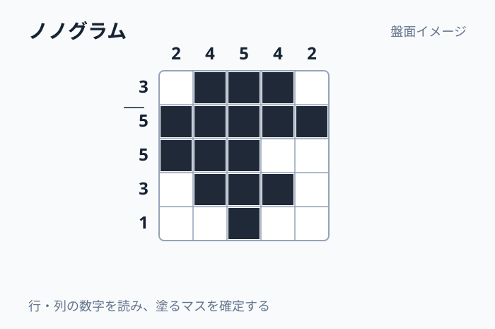
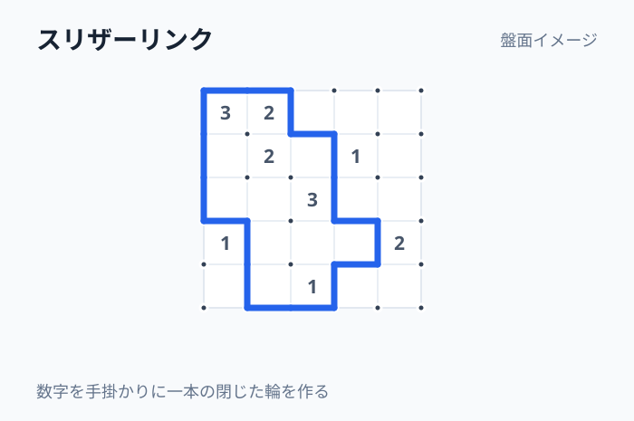
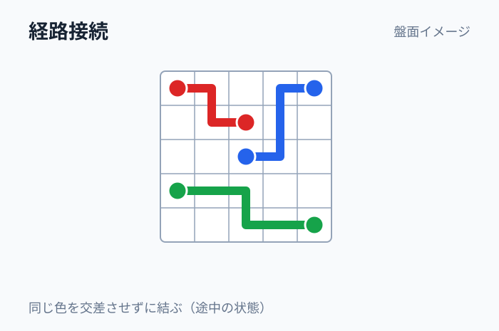
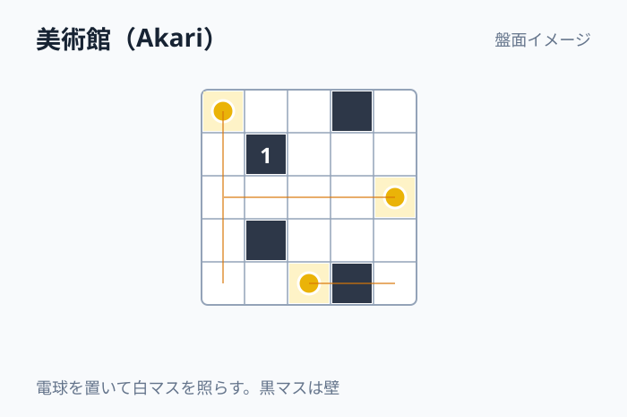
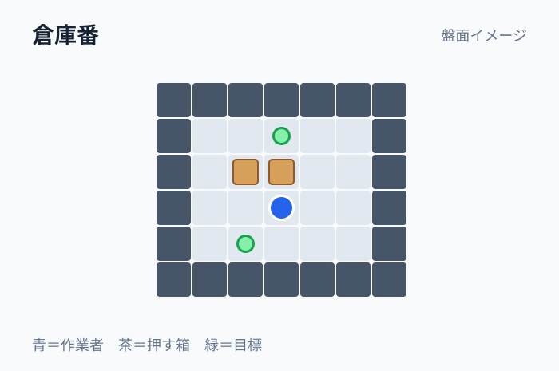

# パズル候補カタログ

候補の名前を知らなくても「何をする遊びか」「どこに面白さがあるか」を比較するための図解つき索引です。導入可否や実装状況を管理するものではありません。

- **盤面の例はすべて模式図です。** 説明のために簡略化しており、完全なルールや一意解・可解性を保証する配布問題ではありません。採用・試遊の判断では実際の代表問題を確認してください。
- **「具体ルール未定」の候補**は、名前だけから独立ゲームの条件を確定できていないものです。盤面の描き方や操作も検討例に留まります。
- 評価点・仮の比較優先度・類似候補の関係は [候補台帳](../パズル候補.csv) で、成立性の根拠は既存の調査資料で確認できます。

## 目次

- [数字・ロジック系](#puzzle-001)（16件）
- [ペンシルパズル系](#puzzle-017)（13件）
- [ソート・移動系](#puzzle-030)（13件）
- [倉庫番・ブロック移動系](#puzzle-045)（5件）
- [迷路・経路系](#puzzle-050)（9件）
- [単語パズル](#puzzle-058)（14件）
- [トランプ・牌系](#puzzle-072)（6件）
- [詰将棋・チェス・囲碁系](#puzzle-078)（6件）
- [物理・空間系](#puzzle-084)（10件）


## 数字・ロジック系

### PUZZLE-001

**ナンプレ** · [導入調査の索引](PUZZLE-001.md)

- **何をするか**：空きマスへ1〜9を入れ、行・列・3×3の各区画で数字を重複させず埋める
- **操作**：数字を選んで空きマスを確定する
- **面白さの核**：候補を排除して一意の数字を導く推理
- **盤面例（模式図）**：

```text
5 ・ ・ │ ・ 7 ・
・ 6 ・ │ 1 ・ ・
──────┼──────
・ ・ 9 │ ・ ・ 4
```

### PUZZLE-002

**キラーナンプレ**

- **何をするか**：ナンプレの条件に加え、点線で囲まれた領域の数字の合計を指定値にする
- **操作**：領域の数字の組合せを考えながら数字を入れる
- **面白さの核**：合計の制約から候補が連鎖して絞れる
- **近い候補との差**：ナンプレに領域の合計という別の制約を追加する変種
- **盤面例（模式図）**：

```text
┌─ 10 ─┐　┌─ 7 ─┐
│ □　□ │　│ □　□ │
└─────┘　└─────┘
```

### PUZZLE-003

**カックロ**

- **何をするか**：縦横の連続する白マスへ、黒マスに書かれた合計になる数字を重複なしで入れる
- **操作**：白マスへ数字を入れる
- **面白さの核**：合計と交差条件の組合せを使う
- **盤面例（模式図）**：

```text
■　＼16　＼7
→9　□　□
→14 □　□
```

### PUZZLE-004

**KenKen / Calcudoku**

- **何をするか**：各行列で数字を重複させず、囲まれた区画の四則演算を成立させる
- **操作**：セルへ数字を入れる
- **面白さの核**：計算式と位置制約を一緒に絞る
- **近い候補との差**：ナンプレの配置条件へ区画の計算式を組み合わせる
- **盤面例（模式図）**：

```text
┌─6×──┐┌3−┐
│ □　□ ││□ □│
└─────┘└───┘
```

### PUZZLE-005

**不等号ナンプレ**

- **何をするか**：ナンプレの条件に加え、隣接する数字間の大小関係を満たす
- **操作**：数字を入力する
- **面白さの核**：大小の連鎖から候補順を確定する
- **近い候補との差**：ナンプレの制約へ隣接セルの大小関係を追加する
- **盤面例（模式図）**：

```text
□ ＜ □ ＞ □
∨　　∧
□ ＞ □ ＜ □
```

### PUZZLE-006

**ビルディングパズル**

- **何をするか**：各行列に高さの異なる建物を配置し、外側から見える建物の数をヒントと一致させる
- **操作**：高さを数字で埋める
- **面白さの核**：高さの遮蔽を逆算する
- **盤面例（模式図）**：

```text
　　2　1　3
3　□ □ □　1
1　□ □ □　2
```

### PUZZLE-007

**バイナリパズル / タクズ** · [導入調査の索引](PUZZLE-007.md)

- **何をするか**：各行・列の0と1の個数を揃え、同じ数字3連続と同一行列を禁止して埋める
- **操作**：0/1を入力する
- **面白さの核**：単純な記号から複雑なパターンが確定する
- **近い候補との差**：ナンプレと違い、使う数字は0・1の2種類で個数と連続を制限する
- **盤面例（模式図）**：

```text
0　・　1　・
・　1　・　0
1　・　・　1
```

### PUZZLE-008

**ひとりにしてくれ**

- **何をするか**：同じ数字が行列で重ならないように一部の数字を塗り潰し、白マスを連結させる
- **操作**：数字セルを白／黒にする
- **面白さの核**：残す数字・消す数字の両立を考える
- **盤面例（模式図）**：

```text
1　2　1　3
3　2　4　1
2　4　1　2
```

### PUZZLE-009

**Hidato** · [導入調査の索引](PUZZLE-009.md)

- **何をするか**：盤面の一部に書かれた数を手掛かりに、隣接する数が縦横斜めで続くよう全数を埋める
- **操作**：数字を空白に配置する
- **面白さの核**：数列の通り道を空間的に復元する
- **近い候補との差**：ナンブリックス（PUZZLE-010）と違い斜めの隣接も認める
- **盤面例（模式図）**：

```text
1　・　3　・
・　・　・　7
・　9　・　・
```

### PUZZLE-010

**ナンブリックス**

- **何をするか**：盤面に連続整数を縦横だけで隣接させるよう空欄を埋める
- **操作**：数字を入力する
- **面白さの核**：一本道の連番経路を推理する（斜め可のHidatoとは異なる）
- **近い候補との差**：Hidato（PUZZLE-009）と違い斜め移動を認めない
- **盤面例（模式図）**：

```text
1　・　・　4
・　・　・　・
9　・　・　12
```

### PUZZLE-011

**魔方陣**

- **何をするか**：縦横および対角線の合計が一致するよう数字を置く
- **操作**：空きマスへ数字を入れる
- **面白さの核**：全体の対称性と合計条件を使う
- **盤面例（模式図）**：

```text
8　・　6
・　5　・
4　・　2
```

### PUZZLE-012

**数式穴埋め**

- **何をするか**：足し算・掛け算などの式にある空欄を埋めて成立させる
- **操作**：空欄へ数や演算子を入力する
- **面白さの核**：制約を逆算して式を完成させる
- **盤面例（模式図）**：

```text
□ ＋ 7 ＝ 12
9 × □ ＝ 36
```

### PUZZLE-013

**24ゲーム**

- **何をするか**：与えられた4数を各1回使い、四則演算と括弧で24を作る
- **操作**：数字と演算子を並べ式を構成する
- **面白さの核**：意外な数の組合せを見つける
- **盤面例（模式図）**：

```text
3　3　8　8
（□ ÷ □）＋□ × □
```

### PUZZLE-014

**覆面算**

- **何をするか**：文字を互いに異なる数字へ置換して筆算を成立させる
- **操作**：文字ごとに数字を割り当てる
- **面白さの核**：桁上がりと文字の共通性を推理する
- **盤面例（模式図）**：

```text
　S E N D
＋M O R E
───────
M O N E Y
```

### PUZZLE-015

**数字ピラミッド**

- **何をするか**：上のマスが直下2マスの合計になるよう数のピラミッドを埋める
- **操作**：数字を入れる
- **面白さの核**：少ない数から全体の加算構造を復元する
- **盤面例（模式図）**：

```text
　　□
　□　□
3　□　7
```

### PUZZLE-016

**数列穴埋め**

- **何をするか**：数列の欠損値と規則を見つける
- **操作**：欠けた数字を入力する
- **面白さの核**：差や比などの規則に気づく
- **盤面例（模式図）**：

```text
2　4　8　□　32
```


## ペンシルパズル系

### PUZZLE-017



**ノノグラム / イラストロジック** · [導入調査の索引](PUZZLE-017.md)

- **何をするか**：行列の連続する塗りマス数から絵になる図形を復元する
- **操作**：マスを塗る／空白を確定する
- **面白さの核**：論理推理の結果が絵として現れる
- **近い候補との差**：一般の数字論理と違い、完成図が絵として現れる
- **盤面例（模式図）**：

```text
　　2　4　5　4　2
3　□ □ □ □ □
5　□ □ □ □ □
5　□ □ □ □ □
3　□ □ □ □ □
1　□ □ □ □ □
```

### PUZZLE-018



**スリザーリンク**

- **何をするか**：格子点の間に線を引き、数字の周囲の線数を満たす一つの閉じた輪を作る
- **操作**：辺をオン・オフする
- **面白さの核**：局所の数字をつないで一つの輪を形作る
- **近い候補との差**：ましゅ（PUZZLE-024）と違い、手掛かりは周囲の線の本数を示す
- **盤面例（模式図）**：

```text
•──•　•──•
│ 2 │ 1　│
•　•──•　•
```

### PUZZLE-019



**経路接続（ナンバーリンク / Flow系）** · [導入調査の索引](PUZZLE-019.md)

- **何をするか**：同色の端点同士を、交差・分岐なしの経路で結び盤面を覆う
- **操作**：マスの間を指でなぞり経路を引く
- **面白さの核**：複数経路の干渉を先読みする
- **近い候補との差**：既存の全マス一筆書きと違い、複数の端点対をそれぞれつなぐ
- **盤面例（模式図）**：

```text
🔴 ・ ・ 🔵
・ ・ ・ ・
🔵 ・ ・ 🔴
```

### PUZZLE-020

**ブリッジパズル / 橋をかけろ** · [導入調査の索引](PUZZLE-020.md)

- **何をするか**：数字のある島を橋でつなぎ、島の本数と全島連結を満たす
- **操作**：島間に橋を1〜2本引く
- **面白さの核**：局所の本数制約と全体接続を両立する
- **近い候補との差**：経路接続（PUZZLE-019）と違い、一本の線でなく島間の橋の本数も決める
- **盤面例（模式図）**：

```text
2　・　3
　　│
1　・　2
```

### PUZZLE-021

**ぬりかべ**

- **何をするか**：数字を島の大きさとし、残りを一続きの海に塗り分ける
- **操作**：マスを陸／海に分類する
- **面白さの核**：島の独立と海の連結を同時に考える
- **盤面例（模式図）**：

```text
2　・　・　1
・　・　3　・
・　・　・　・
```

### PUZZLE-022



**美術館**

- **何をするか**：黒マスに記された周辺電球数を守り、電球同士を照らさず全白マスを照らす
- **操作**：白マスに電球を置く
- **面白さの核**：配置に応じて光が広がる達成感
- **盤面例（模式図）**：

```text
□ □ ■1 □
□ 💡 □ □
■ □ □ ■
```

### PUZZLE-023

**四角に切れ**

- **何をするか**：数字のマスを1つ含み、その数字と面積が一致する長方形で盤を分割する
- **操作**：長方形を選択して囲む
- **面白さの核**：領域の大きさと配置を組み合わせる
- **盤面例（模式図）**：

```text
・　4　・　・
・　・　・　・
3　・　2　・
```

### PUZZLE-024

**ましゅ**

- **何をするか**：白黒の丸の曲がり・直進条件を満たし、線で一つの輪を作る
- **操作**：格子上に線を引く
- **面白さの核**：曲線の局所制約が一つのループへつながる
- **近い候補との差**：スリザーリンク（PUZZLE-018）と違い、丸の位置で曲がり方を制限する
- **盤面例（模式図）**：

```text
•──○　•
│　　│
●　•──•
```

### PUZZLE-025

**へやわけ**

- **何をするか**：部屋ごとの塗りマス数や連続禁止などの条件を満たしてマスを塗る
- **操作**：マスを黒／白にする
- **面白さの核**：部屋の境界と全体連結の制約を読む
- **盤面例（模式図）**：

```text
┌─2─┬─1─┐
│ □ □│□ □│
├────┴────┤
```

### PUZZLE-026

**テントと木**

- **何をするか**：木に隣接するテントを1つずつ配置し、行列の個数条件を満たす
- **操作**：空きマスにテントを置く
- **面白さの核**：対応関係を探し、テントの接触禁止も使う
- **盤面例（模式図）**：

```text
🌳 □ □　1
□ □ 🌳　1
□ □ □　0
```

### PUZZLE-027

**戦艦パズル**

- **何をするか**：艦船の長さと行列ヒントから、艦船が接触しない配置を特定する
- **操作**：マスを船体／海に分類する
- **面白さの核**：見えない艦隊の形と位置を推理する
- **盤面例（模式図）**：

```text
　 1 2 0 1
2 □ □ □ □
1 □ □ □ □
```

### PUZZLE-028

**スターバトル**

- **何をするか**：行・列・太線領域の各条件を満たすよう星を配置し、星同士を隣接させない
- **操作**：マスへ星を置く
- **面白さの核**：領域を横断する制約を組み合わせる
- **盤面例（模式図）**：

```text
┌──┬──┐
│ ☆　□ │ □ □│
├────┼──┤
```

### PUZZLE-029

**マインスイーパー** · [導入調査の索引](PUZZLE-029.md)

- **何をするか**：周囲8マスの地雷数から地雷位置を推理し、安全なマスを開く
- **操作**：マスを開ける／旗を立てる
- **面白さの核**：情報が少しずつ増える緊張感
- **盤面例（模式図）**：

```text
□　1　1　□
□　2　⚑　□
□　□　□　□
```


## ソート・移動系

### PUZZLE-030

**ウォーターソート** · [導入調査の索引](PUZZLE-030.md)

- **何をするか**：同じ色の液体を各瓶にまとめる
- **操作**：注ぎ元と注ぎ先の瓶を選ぶ
- **面白さの核**：空瓶と色の順序をやりくりする
- **近い候補との差**：ボールソート（PUZZLE-031）と近いが、液体を条件に応じてまとめて注ぐ
- **盤面例（模式図）**：

```text
🧪[赤青赤]　🧪[青赤青]
🧪[　　]　🧪[　　]
```

### PUZZLE-031

**ボールソート**

- **何をするか**：色つきボールを容器間で移し、各容器を同色でそろえる
- **操作**：最上段のボールを移動する
- **面白さの核**：容器の空きと色の順序を管理する
- **近い候補との差**：ウォーターソート（PUZZLE-030）と同様の色分別であり独立性は要検討
- **盤面例（模式図）**：

```text
[🔴🔵🔴] [🔵🔴🔵] [　　]
```

### PUZZLE-032

**スライドパズル** · [導入調査の索引](PUZZLE-032.md)

- **何をするか**：空白1マスへ隣のタイルを滑らせ、数字や絵を正しい並びに戻す
- **操作**：隣接タイルを空欄へ移す
- **面白さの核**：少ない空きから移動順を計画する
- **近い候補との差**：パーキングジャムと違い、空白一つの交換で並べ順を復元する
- **盤面例（模式図）**：

```text
1　2　3
4　□　5
7　8　6
```

### PUZZLE-035

**ライツアウト**

- **何をするか**：1マスを押すと自身と周辺の点灯状態が反転し、全体をそろえる
- **操作**：ライトを押して反転する
- **面白さの核**：先の変化を計算してスイッチ順を見つける
- **盤面例（模式図）**：

```text
● ○ ●
○ ● ○
● ○ ●
```

### PUZZLE-036

**ハノイの塔系**

- **何をするか**：大きな円盤を小さな円盤の上へ載せず、全円盤を別の棒に移す
- **操作**：最上段の円盤を棒間で動かす
- **面白さの核**：再帰的な手順を見通す
- **盤面例（模式図）**：

```text
　▂　　　　│　　　│
　▅　　　　│　　　│
　█　　　　│　　　│
```

### PUZZLE-037

**ペグ・ソリティア**

- **何をするか**：盤上の駒を飛び越えて除去し、定められた数・形まで減らす
- **操作**：駒を隣接駒越しに跳ばす
- **面白さの核**：一手ごとに移動可能性が変わる
- **盤面例（模式図）**：

```text
　● ● ●
● ● ○ ● ●
　● ● ●
```

### PUZZLE-038

**パーキングジャム** · [導入調査の索引](PUZZLE-038.md)

- **何をするか**：ほかの車を前後に動かし、目標の車を出口へ出す
- **操作**：車を車軸方向へ滑らせる
- **面白さの核**：混雑の解消手順を組む
- **近い候補との差**：箱入り娘（PUZZLE-040）と違い車の移動方向に制約がある
- **盤面例（模式図）**：

```text
│🚙　🚗│
│🚕🚕→│
│🚙　🚗│
```

### PUZZLE-039

**ラッシュアワー**

- **何をするか**：縦車は縦、横車は横に滑らせ、赤い車を出口へ導く
- **操作**：車を車軸方向に動かす
- **面白さの核**：限られた空白を使って詰まりをほどく
- **近い候補との差**：ブロック脱出（PUZZLE-041）と基本ルールが重なる可能性がある
- **盤面例（模式図）**：

```text
│🚕 →　出口
│🚗 │ 🚙│
│🚗 │ 🚙│
```

### PUZZLE-040

**Klotski / 箱入り娘**

- **何をするか**：異なる大きさの駒を盤内で滑らせ、大きな主役駒を出口へ運ぶ
- **操作**：複数サイズの駒を空白へ移動する
- **面白さの核**：移動の自由度が低い配置を段階的に解く
- **近い候補との差**：パーキングジャムと違い、異なる形の駒を空白で入れ替える
- **盤面例（模式図）**：

```text
┌─┬───┬─┐
│小│　娘　│小│
│縦│ 2×2 │縦│
└──┴─出口┴─┘
```

### PUZZLE-041

**ブロック脱出** · [導入調査の索引](PUZZLE-041.md)

- **何をするか**：複数のブロックを動かし、指定ブロックを出口まで運ぶ
- **操作**：ブロックを移動する
- **面白さの核**：衝突を避けて動かす順序を考える
- **近い候補との差**：箱入り娘（PUZZLE-040）との駒の種類・移動制限による違いを確認する
- **盤面例（模式図）**：

```text
┌──────┐
│■■ □ □│
│ □ 目標→出口│
└──────┘
```

### PUZZLE-042

**パイプパズル** · [導入調査の索引](PUZZLE-042.md)

- **何をするか**：パイプ片をつなぎ、入口から出口まで水路を成立させる
- **操作**：タイルを回転する／つなぐ
- **面白さの核**：曲がりや分岐の向きを揃え、経路を完成する
- **近い候補との差**：電線接続（PUZZLE-043）と似るため、流路のルール差が必要
- **盤面例（模式図）**：

```text
入口→ ─ ┐
　　 │ └
　　 └ ─ →出口
```

### PUZZLE-043

**電線接続**

- **何をするか**：電源と端子の間を、回転できる配線片で接続する
- **操作**：配線タイルを回す
- **面白さの核**：通電経路が一度につながる
- **近い候補との差**：パイプパズル（PUZZLE-042）との差が題材だけにならないか検討する
- **盤面例（模式図）**：

```text
電源⚡ ─ ┐
　　　 │ └─ 💡
```

### PUZZLE-044

**タイル回転系**

- **何をするか**：回転するタイルで絵柄や線の接続条件を成立させる（具体ルール未定）
- **操作**：タイルを回転する想定
- **面白さの核**：回転の連鎖を考える余地はあるが独立した遊びが未確定
- **近い候補との差**：パイプ・電線接続（PUZZLE-042/043）を含む総称で、独立ルール未確定
- **盤面例（模式図）**：

```text
┌──┬──┐
│ └ │ ─ │
├──┼──┤
```


## 倉庫番・ブロック移動系

### PUZZLE-045



**倉庫番**

- **何をするか**：壁のある倉庫で箱を押し、すべてを目標位置へ運ぶ
- **操作**：作業者を動かし箱を押す（引けない）
- **面白さの核**：押せなくなる局面を避けて先読みする
- **近い候補との差**：箱押し（PUZZLE-046）と同系統。基本的には同じルールとして整理する
- **盤面例（模式図）**：

```text
#######
#@ $ .#
#  $ .#
#######
```

### PUZZLE-046

**箱押し**

- **何をするか**：箱を押して所定の位置へ運ぶ（倉庫番とのルール差は未定）
- **操作**：箱を押す
- **面白さの核**：押す順序と行き止まりを考える
- **近い候補との差**：倉庫番（PUZZLE-045）と同系統。独立候補とする差は未確定
- **盤面例（模式図）**：

```text
#####
#@$.#
#####
```

### PUZZLE-047

**ウッドブロック配置**

- **何をするか**：異なる形のブロックを盤へ置き、列や行を消す等の条件を満たす（具体型は要選択）
- **操作**：ブロックをドラッグして配置する
- **面白さの核**：残りの空間を見て配置場所を決める
- **盤面例（模式図）**：

```text
□ □ □ □
■ ■ □ □
手元：L字／長棒
```

### PUZZLE-048

**タイル合わせ**

- **何をするか**：同じ印のタイルを隣接・対応させる（合わせ方の具体ルール未定）
- **操作**：タイルを移動／交換する想定
- **面白さの核**：条件を満たす並びを探す
- **盤面例（模式図）**：

```text
[▲] [●] [▲]
[■] [●] [■]
```

### PUZZLE-049

**麻雀ソリティア**

- **何をするか**：上や左右をふさがれていない同じ牌を組にして取り除く
- **操作**：取れる牌のペアを選ぶ
- **面白さの核**：下層を開く順序と見通しを考える
- **盤面例（模式図）**：

```text
　[東][東]
[一][二][一]
　[二][三]
```


## 迷路・経路系

### PUZZLE-050

**迷路** · [導入調査の索引](PUZZLE-050.md)

- **何をするか**：壁のある通路をたどり、開始点から出口へ到達する
- **操作**：上下左右に進む
- **面白さの核**：分岐を選んで道筋を見抜く
- **近い候補との差**：アイスフロア迷路と違い、1マスずつ止まりながら進める
- **盤面例（模式図）**：

```text
┌─┬────┐
S　│ □　□
└───┐　 G
```

### PUZZLE-051

**完全クリア 迷路**

- **何をするか**：指定の通路やマスをすべて通ってからゴールする（詳細ルール未定）
- **操作**：経路を選ぶ
- **面白さの核**：取りこぼしと戻り道を計画する
- **近い候補との差**：一般の迷路（PUZZLE-050）の通過条件を変えた派生案
- **盤面例（模式図）**：

```text
S ─ □ ─ □
│　 │　 │
□ ─ □ ─ G
```

### PUZZLE-052

**多経路迷路**

- **何をするか**：複数経路の中から条件に合う道を選ぶ（詳細ルール未定）
- **操作**：分岐から道を選ぶ
- **面白さの核**：分岐の組合せを比較する
- **近い候補との差**：一般の迷路（PUZZLE-050）の分岐や道の選択を拡張する派生案
- **盤面例（模式図）**：

```text
S ─┬─ □─G
　 ├─ □─┤
　 └─ □─┘
```

### PUZZLE-053

**六角迷路**

- **何をするか**：六角形のマスで構成された迷路の出口を目指す
- **操作**：六方向の隣接移動で進む
- **面白さの核**：正方格子とは違う分岐構造を読む
- **近い候補との差**：一般の迷路（PUZZLE-050）から盤の格子形状を変えた案
- **盤面例（模式図）**：

```text
　⬡ ⬡
⬡ S ⬡
　⬡ G
```

### PUZZLE-054

**一筆書き**

- **何をするか**：線を一度ずつなぞって図形を描く（点・辺の再訪条件は要定義）
- **操作**：点を結ぶ線を引く
- **面白さの核**：全体の形から通る順序を考える
- **近い候補との差**：オイラー路（PUZZLE-055）と同様に辺を通る想定なら重複する
- **盤面例（模式図）**：

```text
●──●──●
│　 │　 │
●──●──●
```

### PUZZLE-055

**オイラー路問題**

- **何をするか**：グラフの全ての辺を一度ずつ通る経路を探す
- **操作**：辺を通る線を引く
- **面白さの核**：頂点の次数から一筆で通る順序を組む
- **近い候補との差**：一筆書き（PUZZLE-054）に辺の一度ずつ通過する条件を明示したもの
- **盤面例（模式図）**：

```text
A──B──C
│ ╲│　 │
D──E──F
```

### PUZZLE-056

**ハミルトン路問題** · [導入調査の索引](PUZZLE-056.md)

- **何をするか**：盤上の指定マスを一度ずつ通る経路を作る
- **操作**：隣接マス間に一筆で線を引く
- **面白さの核**：全マスを漏れなく通る順番を考える
- **近い候補との差**：オイラー路と違い、辺ではなくマス（頂点）を一度ずつ訪れる
- **盤面例（模式図）**：

```text
S □ □ □
□ □ □ □
□ □ □ G
```

### PUZZLE-057

**点つなぎ**

- **何をするか**：番号付きの点を順に結ぶ（それ以外の論理条件は未定）
- **操作**：点を線でつなぐ
- **面白さの核**：線が絵を形作る達成感
- **盤面例（模式図）**：

```text
1 •　　 • 3
　 • 2
4 •　　 • 5
```

### PUZZLE-094

**アイスフロア迷路** · [導入調査の索引](PUZZLE-094.md)

- **何をするか**：止まるまで滑る床の上で、壁や障害物を利用してゴールへ進む
- **操作**：方向を選び、衝突位置まで滑る
- **面白さの核**：止まれる場所を逆算する
- **盤面例（模式図）**：

```text
S → □ □ ■
□　■ □ □
□ □ □ G
```


## 単語パズル

### PUZZLE-058

**クロスワード**

- **何をするか**：言葉の説明から単語を推測し、縦横交差する白マスを埋める
- **操作**：マスへ文字を入力する
- **面白さの核**：語彙のひらめきと交差による確定が連鎖する
- **盤面例（模式図）**：

```text
■ □ □ □
□ □ ■ □
□ □ □ □
```

### PUZZLE-059

**ワードサーチ**

- **何をするか**：文字が並ぶ格子から指定された単語を探す
- **操作**：隣接する文字列をなぞる
- **面白さの核**：隠れた単語を見つける視覚探索
- **盤面例（模式図）**：

```text
サ ク ラ ホ
イ チ ゴ ナ
ト リ ウ ミ
```

### PUZZLE-060

**アナグラム**

- **何をするか**：与えられた文字を並べ替え、条件に合う単語を作る
- **操作**：文字の順序を入れ替える
- **面白さの核**：文字の組合せを一気に読み替える
- **近い候補との差**：文字並べ替え（PUZZLE-061）と原理上同じ候補
- **盤面例（模式図）**：

```text
「ラ ク サ」→「サ ク ラ」
```

### PUZZLE-061

**文字並べ替え**

- **何をするか**：文字を正しい順序へ並べ直し単語にする（アナグラムとの差は未定）
- **操作**：文字の並べ替え
- **面白さの核**：並べ直した瞬間に意味が見える
- **近い候補との差**：アナグラム（PUZZLE-060）とのルール差が未定
- **盤面例（模式図）**：

```text
「ン ゴ リ」→「リ ン ゴ」
```

### PUZZLE-062

**ワードラダー**

- **何をするか**：ある単語から一度に1文字ずつ変え、各段階で単語を成立させて別の語へ到達する
- **操作**：文字を1つ交換する
- **面白さの核**：言葉の間に見えない道筋を発見する
- **盤面例（模式図）**：

```text
CAT → COT → COG → DOG
```

### PUZZLE-063

**Boggle**

- **何をするか**：格子の隣接する文字をたどり、できるだけ多く単語を見つける
- **操作**：文字を連続してなぞる
- **面白さの核**：視野を切り替えて語を発見する
- **盤面例（模式図）**：

```text
C A T
O R E
D S P
```

### PUZZLE-064

**Wordle型**

- **何をするか**：限られた回数で単語を推測し、位置一致・文字一致のヒントから絞る
- **操作**：推測語を入力する
- **面白さの核**：一手の情報価値を考える
- **近い候補との差**：ハングマンと異なり、単語単位の推測ごとに位置の情報を得る
- **盤面例（模式図）**：

```text
⬛🟨🟩⬛⬛
🟩🟩⬛🟨⬛
□□□□□
```

### PUZZLE-065

**ハングマン**

- **何をするか**：隠された単語を文字当てで復元する
- **操作**：候補文字を選ぶ
- **面白さの核**：外れ回数の制約下で情報を集める
- **盤面例（模式図）**：

```text
_ A _ _ _
使用済：E / S
```

### PUZZLE-066

**フィルインクロスワード**

- **何をするか**：用意された単語リストを、交差する枠の長さに合わせて置く
- **操作**：単語を選び枠へ埋める
- **面白さの核**：単語の配置と交差の整合を考える
- **近い候補との差**：クロスワードと違い、ヒントの代わりに単語候補が先に提示される
- **盤面例（模式図）**：

```text
■ □ □ □
□ □ ■ □
候補：DOG／CAT
```

### PUZZLE-067

**しりとり問題**

- **何をするか**：しりとりの条件を満たす語の列を作る（具体ルール未定）
- **操作**：単語を選んでつなぐ
- **面白さの核**：語尾・語頭の制約から連鎖を組む
- **盤面例（模式図）**：

```text
さくら → らっぱ → ぱんだ
```

### PUZZLE-068

**文字消し**

- **何をするか**：並ぶ文字から一定のルールで文字列を消す（具体ルール未定）
- **操作**：該当文字をなぞる／選ぶ想定
- **面白さの核**：消した後の並びの変化を読む
- **盤面例（模式図）**：

```text
ア イ ア イ
イ ア イ ア
```

### PUZZLE-069

**熟語パズル**

- **何をするか**：文字や漢字を組み合わせて正しい熟語を完成させる
- **操作**：文字を配置・選択する
- **面白さの核**：語構成の知識から欠落を推測する
- **盤面例（模式図）**：

```text
一 □ 二 □
試作候補：四字熟語穴埋め
```

### PUZZLE-070

**漢字クロス**

- **何をするか**：交差する語を漢字で埋める
- **操作**：漢字を選んで交差マスに配置する
- **面白さの核**：交差点を手掛かりに熟語を発見する
- **近い候補との差**：クロスワード（PUZZLE-058）の漢字・熟語への特化案
- **盤面例（模式図）**：

```text
□ 山 □
川 □ 海
□ 林 □
```

### PUZZLE-071

**なぞなぞ**

- **何をするか**：言葉によるひっかけや発想転換を使って答えを考える
- **操作**：自由入力・選択など方式未定
- **面白さの核**：意味の捉え直しに気づく
- **盤面例（模式図）**：

```text
問題文 → ？
答えを考える形式
```


## トランプ・牌系

### PUZZLE-072

**フリーセル**

- **何をするか**：全カードが表向きの盤から、組札へ順番にカードを移す
- **操作**：列間・フリーセル・組札へカードを動かす
- **面白さの核**：有限の空き場所を使い計画的に整理する
- **近い候補との差**：クロンダイク（PUZZLE-073）と異なり、配置情報が最初から公開される
- **盤面例（模式図）**：

```text
♣A　♦2　♥K
列：♠7 ♥6 ♣5
空きセル：□ □
```

### PUZZLE-073

**クロンダイク**

- **何をするか**：カードを色交互・降順に積んで組札へ移す。山札からも補給する
- **操作**：表向きのカードと山札を移す
- **面白さの核**：不確実な展開に合わせて計画を変える
- **盤面例（模式図）**：

```text
　🂠　🂠
♥6 ♣5　🂠
山札：🂠
```

### PUZZLE-074

**スパイダー**

- **何をするか**：複数列のカードを同じスートの降順に並べ完成セットを取り除く
- **操作**：連続したカード列を移す
- **面白さの核**：伏せ札を開く順序を計画する
- **盤面例（模式図）**：

```text
♠K ♠Q ♠J
🂠 🂠 ♠10
🂠 ♠9 ♠8
```

### PUZZLE-075

**ピラミッド**

- **何をするか**：表向きのカード2枚の合計が13になる組を除去する
- **操作**：取れるカードをペアで選ぶ
- **面白さの核**：取り除く順番と盤面を読む
- **盤面例（模式図）**：

```text
　　♠K
　♥6　♣7
♦5　♠8　♥2
```

### PUZZLE-076

**ペア消し**

- **何をするか**：同じ絵柄・数などが合うペアを選んで消す（公開条件は未定）
- **操作**：対応する2枚を選ぶ
- **面白さの核**：消す順番と残りの取りやすさを考える
- **近い候補との差**：麻雀ソリティアや神経衰弱と異なる取得条件が未確定
- **盤面例（模式図）**：

```text
[●] [▲] [●]
[■] [▲] [■]
```

### PUZZLE-077

**神経衰弱**

- **何をするか**：裏向きのカード2枚をめくって一致する組を見つける
- **操作**：カードを2枚ずつ開く
- **面白さの核**：位置を記憶して次の選択につなげる
- **盤面例（模式図）**：

```text
🂠 🂠 🂠
🂠 🂠 🂠
🂠 🂠 🂠
```


## 詰将棋・チェス・囲碁系

### PUZZLE-078

**詰将棋** · [導入調査の索引](PUZZLE-078.md)

- **何をするか**：将棋の局面から、王手を続けて玉を詰ませる
- **操作**：将棋の駒を指す／打つ
- **面白さの核**：相手の応手を読む一本道の構想を見つける
- **盤面例（模式図）**：

```text
　香　・　玉
　・　金　・
持駒：歩
```

### PUZZLE-079

**チェスのN手詰め**

- **何をするか**：指定手数でチェックメイトするチェスの局面を解く
- **操作**：駒を動かす
- **面白さの核**：強制手順を読み切る
- **近い候補との差**：チェス戦術問題（PUZZLE-080）のうちN手の強制メイトに限定する
- **盤面例（模式図）**：

```text
♚　·　·
·　♜　·
♕　·　♔
```

### PUZZLE-080

**チェス戦術問題**

- **何をするか**：チェスの局面で駒得・メイトなど最善の戦術手順を選ぶ
- **操作**：駒を動かす
- **面白さの核**：局所的な戦術パターンに気づく
- **近い候補との差**：N手詰め（PUZZLE-079）より広く、駒得なども対象になる
- **盤面例（模式図）**：

```text
♚　·　♜
·　♘　·
♕　·　♔
```

### PUZZLE-081

**詰碁**

- **何をするか**：囲碁の局所局面で石の生死を確定する手順を解く
- **操作**：交点に石を置く
- **面白さの核**：呼吸点と眼形を読む
- **盤面例（模式図）**：

```text
●─○─┐
│ ● ○ │
└─○─●
```

### PUZZLE-082

**オセロ終盤問題**

- **何をするか**：オセロ終盤の盤から最善の着手を探す
- **操作**：石を置き裏返す
- **面白さの核**：残り空きマスから確定結果を先読みする
- **盤面例（模式図）**：

```text
● ○ ● ○
○ ● · ●
● ○ · ○
```

### PUZZLE-083

**チェッカー終盤**

- **何をするか**：チェッカーの終盤配置で有利・勝利へ至る手順を探す
- **操作**：斜めに駒を動かす
- **面白さの核**：取る順序と昇格を読む
- **盤面例（模式図）**：

```text
□ ● □ ·
· □ ○ □
□ ○ □ ·
```


## 物理・空間系

### PUZZLE-084

**タングラム**

- **何をするか**：幾何図形のピースを回転・移動して指定のシルエットを埋める
- **操作**：形の違うピースを配置する
- **面白さの核**：図形の見方を変えて形を発見する
- **近い候補との差**：詰め込み（PUZZLE-087）と異なり指定シルエットを図形で再現する
- **盤面例（模式図）**：

```text
目標：⬟
ピース：△ △ □ ▱
```

### PUZZLE-085

**ジグソーパズル**

- **何をするか**：不規則な輪郭のピースを噛み合わせて1枚の画像を完成する
- **操作**：ピースをドラッグしてはめる
- **面白さの核**：輪郭・絵柄を手掛かりに完成が進む
- **盤面例（模式図）**：

```text
┌──┬◕┬──┐
│絵柄│　│絵柄│
└──┴──┴──┘
```

### PUZZLE-086

**ブロック配置**

- **何をするか**：さまざまな形のブロックを盤へ配置する（空間埋め・消去など具体ルール未定）
- **操作**：ブロックをドラッグする想定
- **面白さの核**：残り空間を計画する
- **近い候補との差**：ウッドブロック配置・詰め込みとのルール差が未確定
- **盤面例（模式図）**：

```text
□ □ □ □
□ □ □ □
ピース：L／T／棒
```

### PUZZLE-087

**詰め込みパズル**

- **何をするか**：形の違う複数のピースを、余白を残さず枠内へ詰める
- **操作**：ピースを動かす／回転する
- **面白さの核**：局所の形から全体の充填を見通す
- **近い候補との差**：タングラム（PUZZLE-084）と違い、一般のピース配置・充填条件が中心
- **盤面例（模式図）**：

```text
┌─────┐
│ □ □ □ │
└─────┘
手元：L／T／I
```

### PUZZLE-088

**マッチ棒パズル**

- **何をするか**：指定本数のマッチ棒を動かし、式や図形を正しくする
- **操作**：棒を動かす
- **面白さの核**：見た目を変えてひらめく
- **盤面例（模式図）**：

```text
Ⅵ ＋ Ⅰ ＝ Ⅳ
動かせる棒：1本
```

### PUZZLE-089

**ピン抜き**

- **何をするか**：順番にピンを抜いて物体を所定の場所へ移す（具体物理条件未定）
- **操作**：ピンをタップして外す
- **面白さの核**：順番で結果が変わる
- **盤面例（模式図）**：

```text
●─📍─●
　　↓
　　容器
```

### PUZZLE-090

**ロープほどき**

- **何をするか**：交差したロープや紐を操作して絡まりを解く（物理モデル未定）
- **操作**：端点や紐をドラッグする
- **面白さの核**：交差の関係を解消する
- **盤面例（模式図）**：

```text
A ╲　╱ B
　 ╳
C ╱　╲ D
```

### PUZZLE-091

**ネジ外し系**

- **何をするか**：ネジで固定された部品を外す順序を見つける（具体ルール未定）
- **操作**：ネジを選択して外す
- **面白さの核**：固定関係の解除順を考える
- **盤面例（模式図）**：

```text
●════●
　板A
●════●
```

### PUZZLE-092

**物理ボール系**

- **何をするか**：ボールと障害物を動かして目的の状態にする（具体ルール未定）
- **操作**：物体や仕掛けを動かす想定
- **面白さの核**：物理的な結果を予測する
- **盤面例（模式図）**：

```text
⚪　／＼
　↘　　↓
　　ゴール
```

### PUZZLE-093

**リフレクション / Reflection** · [導入調査の索引](PUZZLE-093.md)

- **何をするか**：光の反射や鏡の向きから、条件に合うレーザーの経路を完成させる
- **操作**：鏡などを配置・向きを決める
- **面白さの核**：反射を追って盤面全体を推理する
- **盤面例（模式図）**：

```text
入口→ ／　＼
　　 ＼　／
出口← ───
```

